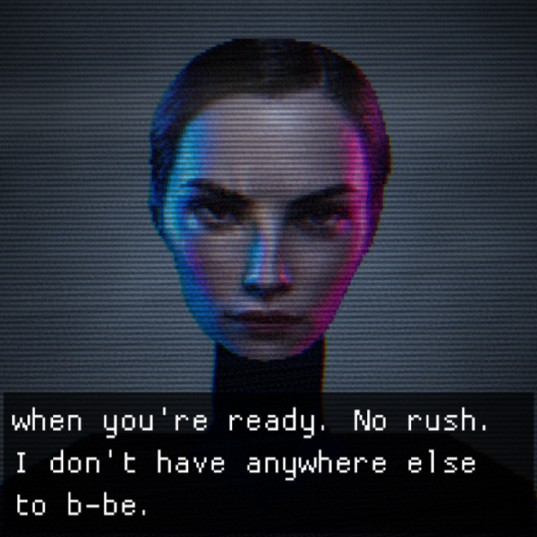
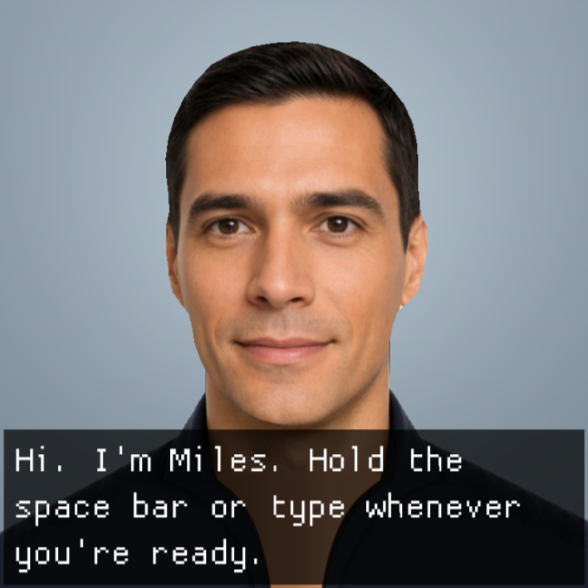

# Rex Static

A glitchy, slightly plastic digital person who lives in a small window on
your Linux desktop. Hold the space bar (or F1) to talk, or type. Answers come from
Claude and are spoken with a local voice (Piper or Kokoro).

Four personas:

- **Rex Static** (male) and **Roxy Static** (female): the 80s look, with a
  CRT screen, glitches and a choppy, stuttering Piper voice.
- **Miles** (male) and **Zosia** (female): a modern look, with a natural
  Kokoro voice, lip sync from the voice's own sounds, real blinks and
  glances, and head turns made from turned photos of the same face.

Pick one in the config file, or ask the persona to switch (for example
"switch to Zosia"). It saves the choice to the config and restarts as the
other one.

| Rex Static | Roxy Static |
|---|---|
|  |  |
| **Miles** | **Zosia** |
|  |  |

## Requirements

- Linux with Wayland and PipeWire (`/usr/bin/pw-cat`)
- `libsecret` (`/usr/bin/secret-tool`) for the API key
- Rust, `uv`, `curl`, `cmake`, `clang`, `bsdtar` (`libarchive`)
- An Anthropic API key
- Optional, for the wake phrase: `vosk-api` (`/usr/lib/libvosk.so`)

On Arch:

```sh
sudo pacman -S --needed rust uv curl pipewire libsecret cmake clang libarchive
sudo pacman -S --needed vosk-api   # only for the wake phrase
```

## Set up

1. Run `./setup.sh`. It installs Piper and Kokoro, downloads the voice and
   speech models (about 750 MB, hash-checked), writes an example config and builds.
2. Store your Anthropic key:

   ```sh
   secret-tool store --label='Rex Static' service rex-static key anthropic
   ```

   Or set `ANTHROPIC_API_KEY` instead.
3. Open **Rex Static** from your app launcher, or run `~/.local/bin/rex-static`.

`setup.sh` installs the program to `~/.local/bin/rex-static` and adds a
launcher entry. After changing code, run `./setup.sh` again to reinstall
(downloads are skipped when the files are already there).

To update to the latest release, run `./update.sh`. It downloads that
release's source to `~/.cache/rex-static`, then builds and installs it with
its own `setup.sh`. It does nothing when you're already on the latest
release; `./update.sh --force` rebuilds anyway.

Only one copy runs at a time. Opening it again brings the open window to
the front (on Hyprland).

## Config

The file is `~/.config/rex-static/config`. See
[`config.example`](config.example) for every key. The main ones:

| Key | What it does |
|---|---|
| `persona` | `male` (Rex), `female` (Roxy), `modern-male` (Miles) or `modern-female` (Zosia) |
| `user_name` | Your name, so the persona can use it |
| `model` | Claude model id (default `claude-haiku-5-5`) |
| `face` | `auto` (built-in head) or `plastic` (plain mannequin, no photo) |
| `brief` | `yes` for one-sentence replies (default `no`) |
| `wake` | `yes` to talk without Space: say "Hey Miles" (default `no`) |
| `claude_code` | Path to `claude`; turns on the Claude Code tool |
| `ha_url`, `ha_pin`, `ha_token_file` | Turn on the Home Assistant tool |
| `mqtt_url`, `mqtt_user` | Turn on Home Assistant announcements |
| `google` | `yes` turns on Gmail and Calendar (see below; default `no`) |
| `morning_update` | Spoken update at 8 AM (default `yes`; see below) |
| `meeting_alerts` | Alert 10 minutes before each event (default `yes`, needs `google`) |
| `mail_alert_from` | Alert for new mail from these addresses (default none, needs `google`) |

With `wake = yes`, say "Hey" and the active persona's name (for example
"Hey Miles", or whatever you renamed them to). Other personas' names are
ignored; to switch, ask ("switch to Zosia"). Say it alone, wait for the
beep, then talk; a pause of about a second ends it. Or say it all at once:
"Hey Miles, what time is it?"
Space still works. A small offline model (Vosk) listens for "hey" all the
time; nothing leaves the machine until a request is heard.

The app ignores the file if someone else owns it or others can write to it.

Asking Claude Code needs your yes first. In Home Assistant, lights,
switches, fans, scenes, media and climate change straight away; locks,
alarms, covers, valves, scripts and automations ask once. Answer "yes
always" and it stops asking for that: for Claude Code, every question; for
Home Assistant, that one service (for example `lock.unlock`). Say "ask first again" to undo all of them. Say "be brief"
or "more detail" to change reply length. Say "use we instead of I" (or the
reverse) to change how every persona refers to itself, built-in lines
included. These choices are saved in
`~/.local/share/rex-static/prefs`, which is ignored if others can write to
it.

Each persona keeps its own name and conversation history. Memory notes about
you are shared between personas.

To change the model, set `model` in the config and restart. No rebuild
needed. Haiku is fast and cheap. Sonnet and Opus give better answers but are
slower and cost more. A value that isn't a `claude-...` id is ignored with a
warning, and the default is used. Newer models get the newer web search tool
automatically.

## Gmail and Calendar

With `google = yes`, the persona can search and read your Gmail, save
draft replies, and read and change your primary Google Calendar. It never
sends mail: a draft waits in Gmail's Drafts folder for you to send.
Adding, moving or deleting an event always asks for a yes, and "always"
doesn't stick for those.

Mail, events and web pages are written by other people. After the persona
reads any of them in a turn, every other action in that turn (lights,
calendar changes, settings) waits for your yes, even ones you said
"always" to.

The app talks to Google directly with your own OAuth client. Set it up
once:

1. In the [Google Cloud console](https://console.cloud.google.com/), create
   a project.
2. Enable the **Gmail API** and the **Google Calendar API** for it.
3. Under **Google Auth Platform**, set up the consent screen: type
   External, your own address as a test user. Then **Publish app** so its
   status is **In production**. While it says "Testing", Google ends the
   sign-in after 7 days. You don't need Google's verification; you'll see
   an "unverified app" warning once when you sign in.
4. Under **Clients**, create an OAuth client of type **Desktop app** and
   download its JSON file.
5. Run:

   ```sh
   rex-static --google-setup ~/Downloads/client_secret_XXXX.json
   ```

   A browser opens. Sign in, accept the warning, and allow all three
   permissions. The client and the sign-in token go to your keyring
   (`secret-tool`, service `rex-static`); you can delete the JSON file.
6. Add `google = yes` to the config and restart Rex Static.

The permissions are read-only Gmail, Gmail drafts (`gmail.compose`, which
Google also uses for sending, though the app never calls send) and
Calendar events. To revoke, remove "Rex Static" (or your project's name)
at <https://myaccount.google.com/permissions>.

## Timed updates

- **Morning update.** At 8 AM the persona reads the weather, today's
  events and important unread mail. If the computer was asleep at 8, it
  comes when it wakes, but only before noon, and only once a day.
  Weather comes from a Tempest station: the token and station from the
  Tempest weather bar plugin's settings in `~/.config/omarchy/shell.json`,
  or the `TEMPEST_TOKEN` and `TEMPEST_STATION_ID` environment variables.
  With no station and no Google, there's nothing to say, so it stays quiet.
- **Meeting alerts.** "In 10 minutes: Dentist." All-day events are skipped.
- **Mail alerts.** "New email from Sam: Lunch?" for senders in
  `mail_alert_from` only, from when the app starts.

Alerts are read out as is and stay out of the chat memory. Mail and event
text is never treated as instructions.

## Home Assistant announcements

Home Assistant automations can make the persona speak, for example
"The coffee pot is off." The app connects out to your MQTT broker. Nothing
listens on your machine.

1. Set `mqtt_url` (and `mqtt_user`, if your broker needs a login) in the
   config.
2. Store the broker password in the keyring:

   ```sh
   secret-tool store --label='Rex Static MQTT' service rex-static key mqtt
   ```

3. Restart the app. Home Assistant finds a **Rex Static** device through MQTT
   discovery, with a `notify.rex_static` entity and a connectivity sensor.
4. In an automation, call `notify.send_message` on `notify.rex_static` with
   the text to speak.

How messages are handled:

- Text is spoken as sent, without Claude rewording it, and isn't added to
  the conversation history.
- If the persona is talking, the announcement waits its turn.
- If the app is closed, the message is dropped.
- Messages older than 2 minutes are dropped, so a backlog isn't read out
  after your machine wakes from sleep.
- Text over 500 characters is cut.

Other senders publish JSON to `rex-static/say`, with `ts` in Unix seconds:

```json
{"text": "The coffee pot is off.", "ts": 1800000000}
```

## Tuning in code

These need a rebuild (`cargo build --release`):

- `IDLE_SWAY` in `src/main.rs`: how much the head moves when not talking.
- `SHORT_FILLER_AFTER`, `LONG_FILLER_AFTER` in `src/main.rs`: how long to
  wait before a "hmm" or a "let me check". Fast answers get no filler; a
  tool call gets "let me check" straight away.
- `SHORT_FILLERS`, `LONG_FILLERS` in `src/persona.rs`: the filler lines.

## Making the face images

The mouth, eye and turned-head images for Miles and Zosia are made from the
built-in photos with [LivePortrait](https://github.com/KwaiVGI/LivePortrait),
using the scripts in `tools/`; see the notes at the top of each script.

Rex and Roxy keep the warped mouth and mesh head turn on purpose: it suits
their choppy 80s look.

## Window

The window starts at 375 × 375 logical pixels, which is 600 screen pixels
at a 1.6 monitor scale. Drag it with the left mouse button. Resize it and it
keeps that size across restarts and persona switches (saved in
`~/.local/share/rex-static/window-size`).

On Hyprland, Rex also remembers which monitor you left it on and where, and
opens there next time (saved in `~/.local/share/rex-static/window-place`).
If that monitor isn't connected, the window rule places it. Float and pin it,
with no `size` in the rule so the saved size wins. Pinning keeps Rex on its
monitor while that monitor switches workspaces; drag it to another monitor
and it stays there.

```lua
o.window({ class = "^rex-static$" }, { float = true, center = true, keep_aspect_ratio = true, pin = true })
```

Or in `hyprland.conf` syntax:

```
windowrule = float, class:^rex-static$
windowrule = center, class:^rex-static$
windowrule = pin, class:^rex-static$
```

## Talk from any window

Space and F1 only work while the Rex window has focus. To hold F1 from any
window, bind it in Hyprland. Rex starts listening on `SIGUSR1` and sends on
`SIGUSR2`. Add this to `~/.config/hypr/bindings.lua`:

```lua
o.bind_hold("F1", "Rex: start listening", "/usr/bin/pkill -USR1 -x rex-static", "Rex: stop and send", "/usr/bin/pkill -USR2 -x rex-static")
```

Or in `hyprland.conf` syntax:

```
bind = , F1, exec, /usr/bin/pkill -USR1 -x rex-static
bindrtn = , F1, exec, /usr/bin/pkill -USR2 -x rex-static
```

Release 0.8.0 or later must be running first; an older Rex quits on these
signals.

## Data

Everything lives in `~/.local/share/rex-static/`: the voice and speech
models, the Kokoro install, `memory.db` (conversation history and notes),
`prefs`, and the saved window size and place. The head images are built
into the program. Tests use a temp folder and never touch it.

## Credits

Head images are AI-generated. The mouth, eye and turned-head images for
Miles and Zosia are made from them with LivePortrait. Voices: Piper `en_US-ryan-high`
and `en_US-lessac-high`, and Kokoro-82M `am_puck` and `af_aoede`. Speech recognition: whisper.cpp `base.en`.

`setup.sh` downloads the voice and speech models; they aren't part of this
repo and have their own licences. See the model cards for
[ryan](https://huggingface.co/rhasspy/piper-voices/blob/v1.0.0/en/en_US/ryan/high/MODEL_CARD),
[lessac](https://huggingface.co/rhasspy/piper-voices/blob/v1.0.0/en/en_US/lessac/high/MODEL_CARD),
[Kokoro-82M](https://huggingface.co/hexgrad/Kokoro-82M) (Apache-2.0, run with
[kokoro-onnx](https://github.com/thewh1teagle/kokoro-onnx))
and [whisper.cpp](https://huggingface.co/ggerganov/whisper.cpp).

`vendor/miniquad` is a patched copy of
[miniquad](https://github.com/not-fl3/miniquad) 0.4.11 (MIT or Apache-2.0):
left-click drags the window.
