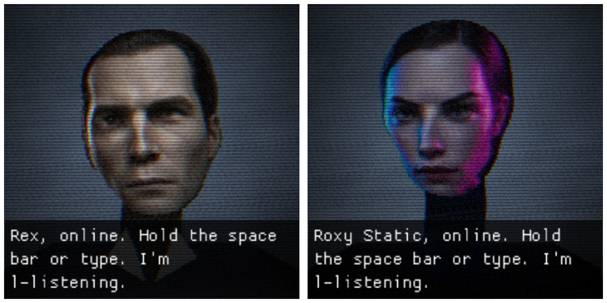

# Rex Static

A glitchy, slightly plastic digital person who lives in a small window on
your Linux desktop. Hold the space bar to talk, or type. Answers come from
Claude and are spoken with a local Piper voice.

Four personas:

- **Rex Static** (male) and **Roxy Static** (female): the 80s look, with a
  CRT screen, glitches and a choppy, stuttering voice.
- **Miles** (male) and **Zosia** (female): a modern look, with smooth motion,
  soft lighting and a natural voice.

Pick one in the config file, or ask the persona to switch (for example
"switch to Zosia"). It saves the choice to the config and restarts as the
other one.



## Requirements

- Linux with Wayland and PipeWire (`/usr/bin/pw-cat`)
- `libsecret` (`/usr/bin/secret-tool`) for the API key
- Rust, `uv`, `curl`, `cmake`, `clang`
- An Anthropic API key

On Arch:

```sh
sudo pacman -S --needed rust uv curl pipewire libsecret cmake clang
```

## Set up

1. Run `./setup.sh`. It installs Piper, downloads the voice and speech
   models (about 380 MB, hash-checked), writes an example config and builds.
2. Store your Anthropic key:

   ```sh
   secret-tool store --label='Rex Static' service rex-static key anthropic
   ```

   Or set `ANTHROPIC_API_KEY` instead.
3. Open **Rex Static** from your app launcher, or run `~/.local/bin/rex-static`.

`setup.sh` installs the program to `~/.local/bin/rex-static` and adds a
launcher entry. After changing code, run `./setup.sh` again to reinstall
(downloads are skipped when the files are already there).

Only one copy runs at a time. Opening it again brings the open window to
the front (on Hyprland).

## Config

The file is `~/.config/rex-static/config`. See
[`config.example`](config.example) for every key. The main ones:

| Key | What it does |
|---|---|
| `persona` | `male` (Rex), `female` (Roxy), `modern-male` (Miles) or `modern-female` (Zosia) |
| `user_name` | Your name, so the persona can use it |
| `model` | Claude model id (default `claude-haiku-5-5`) |
| `face` | `auto` (built-in head), `plastic` or `photo` |
| `claude_code` | Path to `claude`; turns on the Claude Code tool |
| `ha_url`, `ha_pin`, `ha_token_file` | Turn on the Home Assistant tool |
| `mqtt_url`, `mqtt_user` | Turn on Home Assistant announcements |

The app ignores the file if someone else owns it or others can write to it.

Each persona keeps its own name and conversation history. Memory notes about
you are shared between personas.

To change the model, set `model` in the config and restart. No rebuild
needed. Haiku is fast and cheap. Sonnet and Opus give better answers but are
slower and cost more. A value that isn't a `claude-...` id is ignored with a
warning, and the default is used. Newer models get the newer web search tool
automatically.

## Home Assistant announcements

Home Assistant automations can make the persona speak, for example
"The coffee pot is off." The app connects out to your MQTT broker. Nothing
listens on your machine.

1. Set `mqtt_url` (and `mqtt_user`, if your broker needs a login) in the
   config.
2. Store the broker password in the keyring:

   ```sh
   secret-tool store --label='Rex Static MQTT' service rex-static key mqtt
   ```

3. Restart the app. Home Assistant finds a **Rex Static** device through MQTT
   discovery, with a `notify.rex_static` entity and a connectivity sensor.
4. In an automation, call `notify.send_message` on `notify.rex_static` with
   the text to speak.

How messages are handled:

- Text is spoken as sent, without Claude rewording it, and isn't added to
  the conversation history.
- If the persona is talking, the announcement waits its turn.
- If the app is closed, the message is dropped.
- Messages older than 2 minutes are dropped, so a backlog isn't read out
  after your machine wakes from sleep.
- Text over 500 characters is cut.

Other senders publish JSON to `rex-static/say`, with `ts` in Unix seconds:

```json
{"text": "The coffee pot is off.", "ts": 1800000000}
```

## Tuning in code

These need a rebuild (`cargo build --release`):

- `IDLE_SWAY` in `src/main.rs`: how much the head moves when not talking.
- `SHORT_FILLER_AFTER`, `LONG_FILLER_AFTER` in `src/main.rs`: how long to
  wait before a "hmm" or a "let me check". Fast answers get no filler; a
  tool call gets "let me check" straight away.
- `SHORT_FILLERS`, `LONG_FILLERS` in `src/persona.rs`: the filler lines.

## Your own head image

Put `rex.png`, `roxy.png`, `miles.png` or `clara.png` in `~/.local/share/rex-static/` to replace the
built-in head. It needs the same layout as the built-in image (face centred,
looking forward), or the mouth and eyes won't line up.

## Window

The window is 375 × 375 logical pixels, which is 600 screen pixels at a 1.6
monitor scale. Drag it with the left mouse button. On Hyprland, float it:

```lua
o.window({ class = "^rex-static$" }, { float = true, center = true, keep_aspect_ratio = true, size = { 375, 375 } })
```

Or in `hyprland.conf` syntax:

```
windowrule = float, class:^rex-static$
windowrule = center, class:^rex-static$
```

## Data

Everything lives in `~/.local/share/rex-static/`: models, `memory.db`
(conversation history and notes) and any head images. Tests use a temp
folder and never touch it.

## Credits

Head images are AI-generated. Voices: Piper `en_US-ryan-high`,
`en_US-lessac-high`, `en_US-hfc_male-medium` and `en_US-amy-medium`. Speech recognition: whisper.cpp `base.en`.

`setup.sh` downloads the voice and speech models; they aren't part of this
repo and have their own licences. See the model cards for
[ryan](https://huggingface.co/rhasspy/piper-voices/blob/v1.0.0/en/en_US/ryan/high/MODEL_CARD),
[lessac](https://huggingface.co/rhasspy/piper-voices/blob/v1.0.0/en/en_US/lessac/high/MODEL_CARD),
[hfc_male](https://huggingface.co/rhasspy/piper-voices/blob/v1.0.0/en/en_US/hfc_male/medium/MODEL_CARD),
[amy](https://huggingface.co/rhasspy/piper-voices/blob/v1.0.0/en/en_US/amy/medium/MODEL_CARD)
and [whisper.cpp](https://huggingface.co/ggerganov/whisper.cpp).

`vendor/miniquad` is a patched copy of
[miniquad](https://github.com/not-fl3/miniquad) 0.4.11 (MIT or Apache-2.0):
left-click drags the window.
